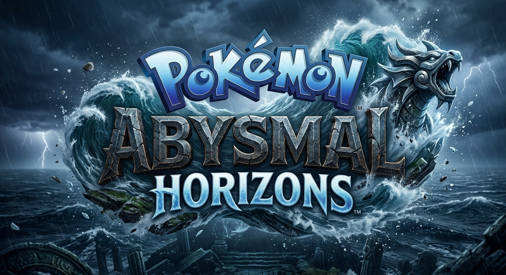

# Pokémon Abysmal Horizons

**Pokémon Abysmal Horizons** is a fan-made decompilation and recompilation project bringing together elements inspired by *Pokémon SoulSilver*, *Pokémon White 2*, *Pokémon Platinum*, *Pokémon Alpha Sapphire*, *Pokémon X*, and *Pokémon Ultra Moon* in one connected, fully playable online Pokémon adventure.

Explore seven Pokémon regions, play alongside other trainers in a massive multiplayer world, and take on a new journey that builds on the familiar games while adding original content and visual upgrades.

## Features

- **Seven regions:** Kanto, Johto, Hoenn, Sinnoh, Unova, Kalos, and Alola.
- **Online multiplayer:** A shared adventure designed for trainers to play together.
- **Mega Evolution:** Bring Mega Evolution into the expanded journey.
- **New story content:** The story continues with completely new content after the Kanto portion of the adventure.
- **Early-game extras:** Small additions and gifts are planned before completing the Kanto region.
- **Enhanced 2D/3D presentation:** A 2D/3D visual style with many replaced and upgraded textures, including HD stones, wood, wallpapers, sand, grass, water, and more.
- **Room to grow:** New regions are planned for future updates.

## About the project

Abysmal Horizons reimagines familiar Pokémon worlds as one larger adventure. Its goal is to combine exploration, story, multiplayer, and visual enhancements while leaving room for the world to expand with future regions and content.

## Credits

**Author and project creator:** [tokyubevoxelverse](mailto:tokyubevoxelverse@gmail.com)

Pokémon and the Pokémon game titles referenced here are the property of their respective owners. This is an unofficial, fan-made project and is not affiliated with or endorsed by Nintendo, Game Freak, or The Pokémon Company. No game ROMs or other proprietary game files are included in this repository.
